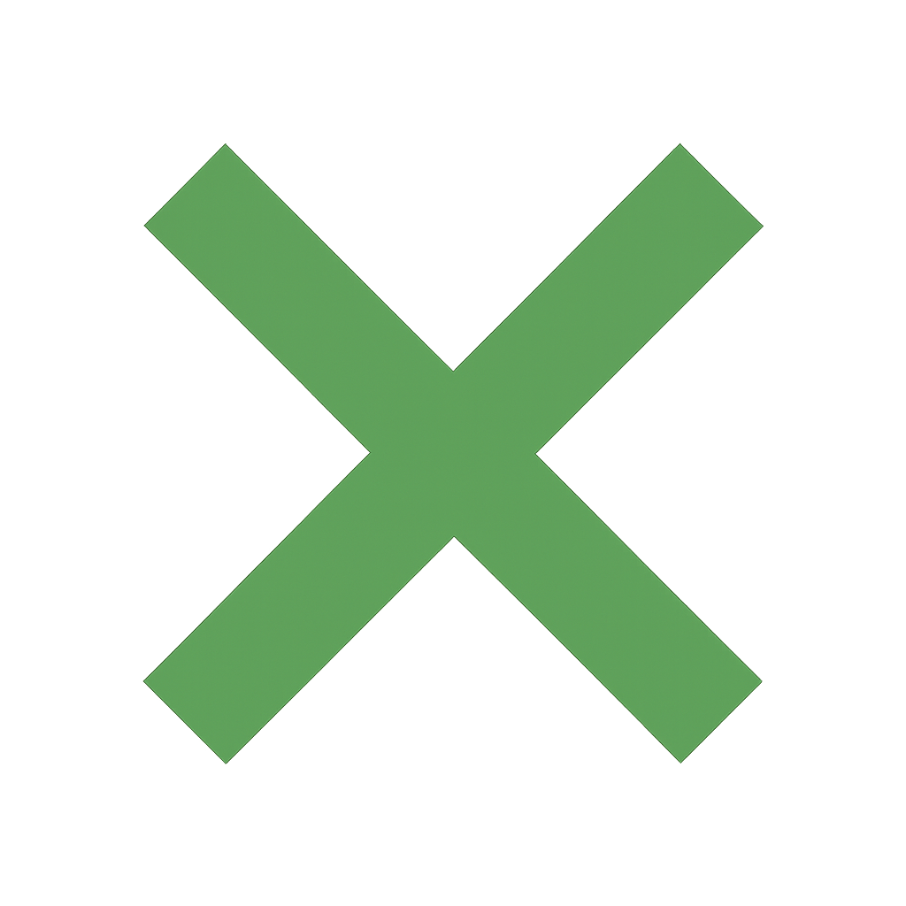
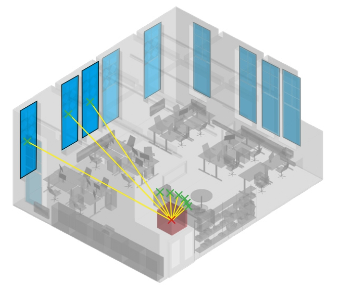
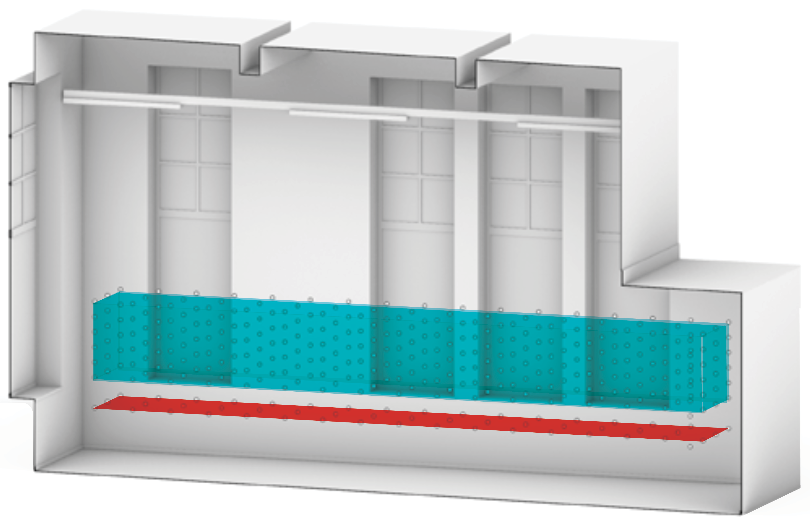
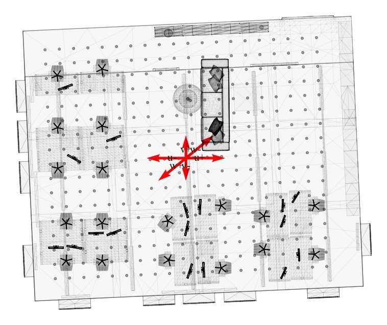

### Code and data for [Geometrical Levels of Detail for Indoor Daylight Simulation]()


### Folder structure

- `code`:
  - `jobs`: *example cluster job scripts*.
  - `postprocess`: *post-processing scripts for analysis and visualization*
  - `src`: main source codes for daylight simulations, and cubic-illuminance implementations.
- `Figures`: figures and plots for both vizualisation and data analysis in the paper.
- `inputs`: geometries, simulation grids, and weather files for rooms 1 and 2. Please refer to 4TU repository for full access. [](https://doi.org/10.4121/aea693b6-6626-4862-a09c-2d4d0753d6f2)


---
### Solid angle calculation
### Normalized Solid Angle (NSA)

The Normalized Solid Angle (NSA) is calculated as:

$`NSA = \frac{Ω}{A_w}`$

where:

- $`Ω`$ — cumulative apparent solid angle subtended by the window mesh triangles from the centroid of the non-permanent object, counted only when the line between the object's centroid and a triangle's centroid is unobstructed by other objects in the room (steradians).
- $`A_w`$ — total window area in the room (m²).

The implementation is in `input_station.py`, function `calculate_solid_angle()`.`Threshods` class 


This includes a visibility check.  For example, if from the centroid of the red flower box (❌). the first conjunction point () on the connecting line to the windows () is on the window pane(🟦), then the solid angle of that triangle is added to the total solid angle of the window as seen from the centroid of the flower box.
<p align="center">

</p>

---
### Cubic sensor grids and cubic quantities

The analysis grid in this work represents head-poses as shown in the blue region in the figure below, as opposed to the workplane (in red):
<p align="center">
  
</p>

This is implemented in `cuttle` class in `cuttle.py` , which has two key functionalities: 
1. Creates cubic sensor definitions from a given list of points (as a simple `.txt`) for 2-phase simulation. `space_angle` is set to 0 by default, which means the cubic point directions will be aligned with the global coordinate system (see the figure below). If a non-zero `space_angle` is provided, the cubic sensors will be rotated accordingly.

<p align="center">
  
</p>

2. Calculates the cubic quantities from the raw Radiance results, with quantities that correspond to those proposed by [Christopher Cuttle](https://www.researchgate.net/profile/Christopher-Cuttle/publication/274538293_Research_Note_A_practical_approach_to_cubic_illuminance_measurement/links/56a6d84b08ae997e22ba4fc6/Research-Note-A-practical-approach-to-cubic-illuminance-measurement.pdf). 


---

### About the Daylight simulation engine
This respository uses an advance 2-phase annual daylight simulation (see `CBDM.py`) method based on Radiance v5.4.

[](https://github.com/LBNL-ETA/Radiance/tree/rad5R4)
---
### Citation
If you use the code/program (or part) of this work, please cite our paper:

```
The manuscript is under preparation.
```

---

### License
This repository uses the [MIT License](https://opensource.org/licenses/MIT). This allows free use, modification, and redistribution with attribution. (see also `./LICENSE`)

---

If you have any questions, comments, or suggestions, please feel free to contact me at:
Forouzandeh.nima@gmail.com; n.forouzandeh@tudelft.nl

November, 2025

Copyright (C) 2025 | Nima Forouzandeh


